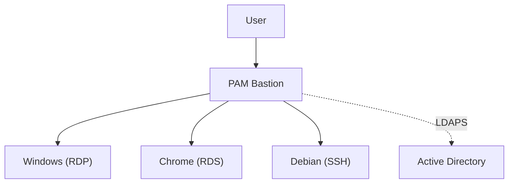

<div align="center">

# `0xEmhddsi-Net`

**Systems & Network Administration** · **Cyber Defense** · **Zero Trust**

*Building secure, segmented, auditable infrastructure, one lab at a time.*


</div>

---

```bash
$ whoami
0xEmhddsi-Net

$ cat about.txt
Sysadmin foundations (Windows Server, Linux, networking)
+ a defender's mindset (PAM, NGFW, EDR, SIEM, MFA)
= infrastructure that is segmented, encrypted and auditable.

$ cat principles.txt
never trust, always verify
least privilege, always
if it isn't logged, it didn't happen
document everything, break it on purpose, fix it, repeat
```

---

## 🔭 What I work on

- 🛡️ **Privileged Access Management and Zero Trust**: brokering every admin session through a bastion
- 🔐 **Identity and encrypted auth**: Active Directory, LDAPS, PKI
- 🧱 **Network segmentation**: VLANs, isolated zones, firewalls
- 🕵️ **Detection labs**: simulating attacks (recon, scanning, brute force) and catching them in a SIEM
- 🐧 **Linux and virtualization**: Debian, Proxmox VE, VMware

---

## 📌 Featured project

<table>
<tr>
<td width="70%">

### 🏰 [Zero Trust Architecture with WALLIX Bastion (PAM)](https://github.com/0xEmhddsi-Net/Architecture-Zero-Trust-Wallix-Bastion-PAM)

A zero-trust lab where **nobody touches a target directly**. All access is brokered, authenticated and audited through a PAM bastion.

`RDP → Windows Server` · `RDS → Chrome RemoteApp` · `SSH → Debian` · `LDAPS (636), not LDAP`

Isolated network zones, separated admin and user planes, AD + PKI, and a full step-by-step screenshot walkthrough.

</td>
<td>



</td>
</tr>
</table>

---

## 🧪 More projects

<table>
<tr>
<td width="50%" valign="top">

### 🌐 [Hybrid Cyber Defense Lab](https://github.com/0xEmhddsi-Net/Hybrid-Cyber-Defense-Lab)

A **hybrid segmented network** mixing physical Cisco hardware with a virtualized Proxmox lab, built to keep Red Team traffic strictly away from the physical LAN.

- 🔌 Physical **VLAN segmentation** on a Cisco router (dedicated lab VLAN, off the management VLAN)
- 🔒 A **"Virtual Cage"**: a Linux bridge with no physical ports, forcing all traffic through **pfSense**
- 🏢 Windows Server **Active Directory / DHCP** on the isolated bridge
- 🐛 Root-caused and fixed a **rogue DHCP leak** onto the physical network

`Proxmox VE` `Cisco` `VLAN` `pfSense` `Active Directory`

</td>
<td width="50%" valign="top">

### 🔍 [Splunk Attack Detection Lab](https://github.com/0xEmhddsi-Net/splunk-attack-detection-lab)

A **Red vs Blue** setup: attacks launched from Kali, detected in real time by a **Splunk SIEM** watching a Debian server.

- 📡 **Ping sweep** detected through `iptables` ICMP logging
- 🎯 **Nmap port scan** detected from rapid SYN traffic
- 🔑 **SSH brute force** detected from `auth.log` failed logins
- 🧯 Fixed a **disk-full outage** from recovery mode (`fdisk`, `growpart`, swap rebuild) with no data loss

`Splunk` `Kali` `Nmap` `iptables` `rsyslog` `Debian`

</td>
</tr>
</table>

---

## 🧰 Toolbox

| Area | Tech |
|---|---|
| **Access and identity** | WALLIX Bastion · Active Directory · GPO · LDAPS · PKI (AD CS) · MFA |
| **Network security** | pfSense · iptables · Palo Alto NGFW · Barracuda WAF · Forcepoint SWG · FortiNAC |
| **Endpoint and data** | Kaspersky EDR · Tripwire (FIM) · PGP encryption |
| **Monitoring and offense** | Splunk Enterprise · rsyslog · Kali Linux · Nmap |
| **Systems** | Windows Server · Debian Linux · Proxmox VE · VMware Workstation |
| **Networking** | TCP/IP · VLAN · DNS · DHCP · SSH · Cisco (physical VLAN config) |

---

## 🎓 Certifications

- ✅ **CompTIA Security+**
- ✅ **Cyber Defense Administrator**, program certificate
- 📘 **Linux Unhatched** (Cisco)

---

## 🎯 Currently

- 🔨 Writing up labs as clean, reproducible documentation
- 📚 Going deeper on detection engineering and SIEM use cases
- 🧭 Looking for a junior role in **systems administration or cyber defense**

---

<div align="center">

*"The best way to learn security is to build it, break it, and write it down."*

</div>
